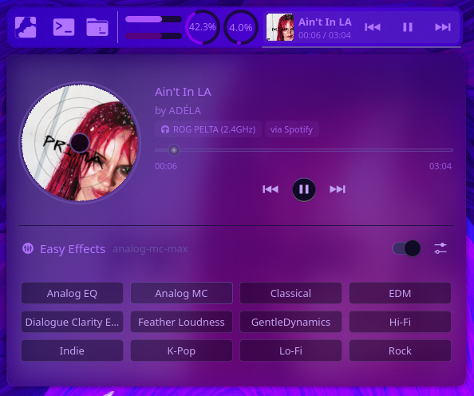

# Nyx Player

A KDE Plasma 6 panel music player with a spinning vinyl cover and an [Easy Effects](https://github.com/wwmm/easyeffects) preset switcher.



All colors come from your active Plasma theme, so it matches whatever theme you use.

## Features

- **Panel view:** cover art, title, elapsed / total time, and previous / play / next buttons
- **Popup:**
  - spinning vinyl-style cover
  - title, artist, the audio output in use, and the app that's playing
  - seek bar and playback controls
- **Easy Effects section:**
  - every output preset as a button
  - one on/off switch for all effects
  - a button that opens the Easy Effects window
- **Preset intensity:** presets named `name-min` / `name-max` are grouped into one button, with an Intensity toggle between the two

Works with any player that supports MPRIS: Spotify, browsers, VLC, mpv and others.

## Requirements

- KDE Plasma 6 (tested on 6.7.5)
- Easy Effects (only for the Easy Effects section, but the popup expects it)
- WirePlumber (`wpctl`), which most PipeWire setups already have

## Install

**From the KDE Store:** right-click your panel → **Add or Manage Widgets…** → **Get New Widgets…** → **Download New Plasma Widgets…**, search for **Nyx Player** and click **Install**. Or download it from its [KDE Store page](https://store.kde.org/p/2378511).

**From GitHub:**

```bash
git clone https://github.com/OthrineTM/nyx-player.git
kpackagetool6 --type Plasma/Applet --install nyx-player/package
```

Then right-click your panel → **Add or Manage Widgets…**, search for **Nyx Player**, and drag it onto the panel.

**Update:** `git pull`, then `kpackagetool6 --type Plasma/Applet --upgrade nyx-player/package`, then `systemctl --user restart plasma-plasmashell`.

**Remove:** `kpackagetool6 --type Plasma/Applet --remove io.github.othrinetm.nyxplayer`

## Notes

- Easy Effects presets are read from `~/.local/share/easyeffects/output`. If Easy Effects isn't running, the widget starts it in the background (`--service-mode`).
- The widget uses Plasma's private MPRIS QML module (`org.kde.plasma.private.mpris`), the same one the built-in Media Player widget uses. A big Plasma update could break it.

## See also

- [Nyx Control](https://github.com/OthrineTM/nyx-control): control center with notifications, clipboard, system gauges and quick toggles
- [Nyx Clock](https://github.com/OthrineTM/nyx-clock): customizable desktop clock with weekday, date and weather

## License

GPL-3.0-or-later. See [LICENSE](LICENSE).
